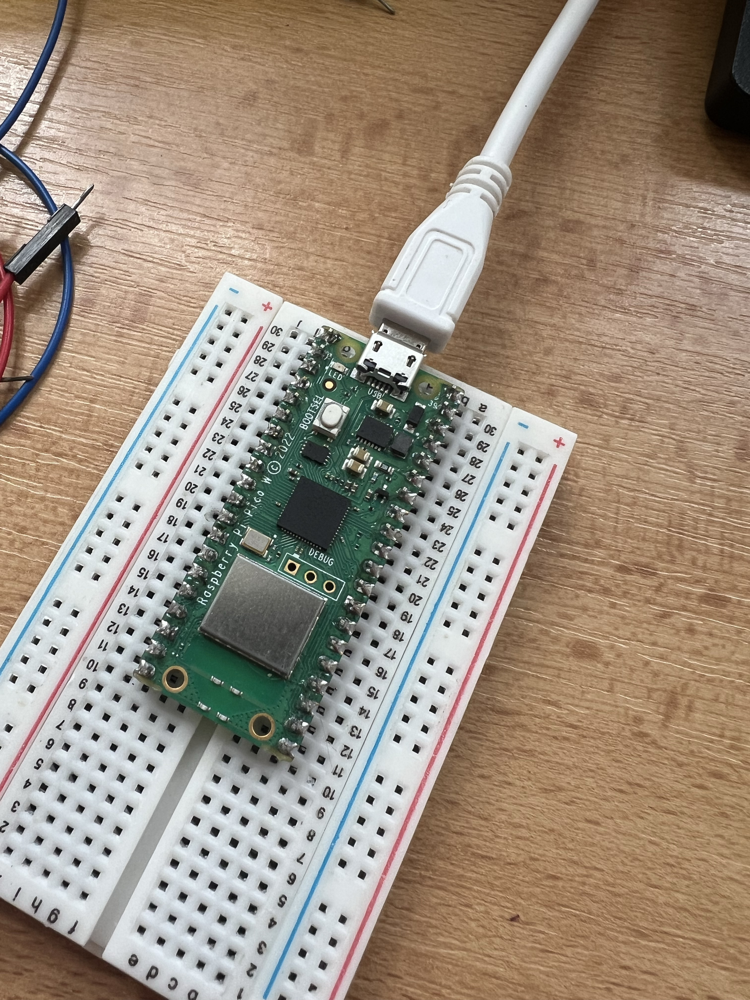

# Úloha 0: Blikání LED (Blinking LED)

Základní úloha pro seznámení s mikrokontrolérem Raspberry Pi Pico a jazykem MicroPython.

## Popis funkce
Program v nekonečné smyčce periodicky po 1 sekundě přepíná stav vestavěné LED diody na desce (`toggle()`).

## Použitý hardware
- Raspberry Pi Pico
- Vestavěná indikační LED (`Pin("LED", Pin.OUT)`)

## Zapojení
Pro tuto úlohu není potřeba žádné externí zapojení – využívá se interní LED na desce.

## Spuštění
Kód v souboru [blink.py](blink.py) nahrajte a spusťte v prostředí Thonny / MicroPico na připojeném Raspberry Pi Pico.

## Foto

