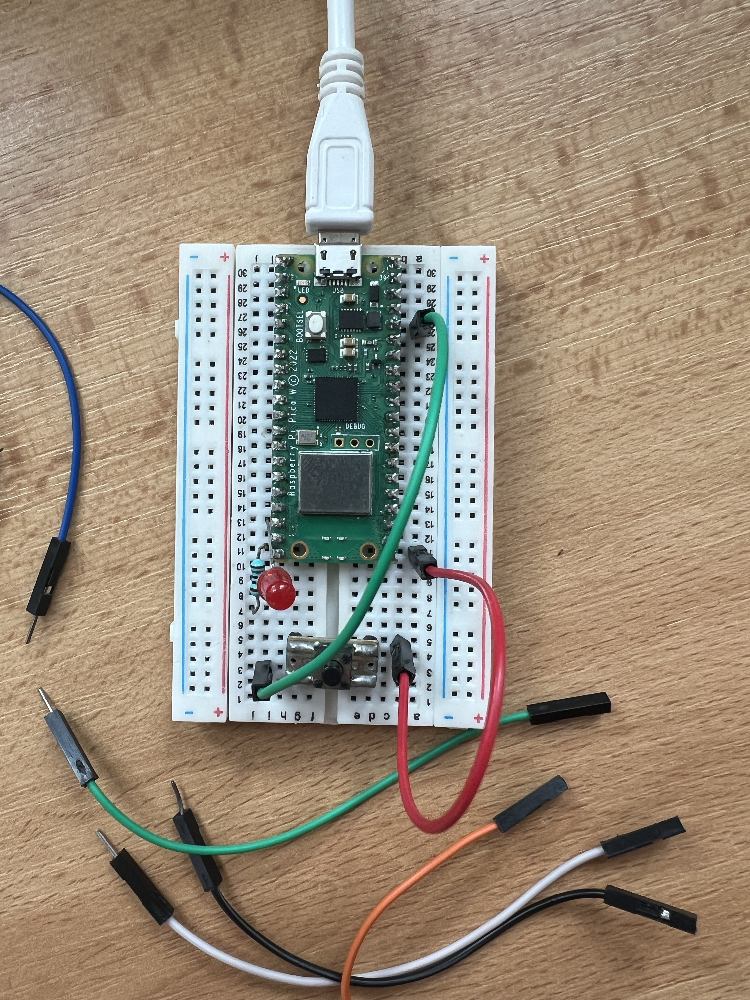

# Úloha 1: Digitální vstup a výstup (Digital I/O)

Úloha demonstruje práci s digitálním vstupem (tlačítko) a digitálním výstupem (LED dioda).

## Popis funkce
Při každém stisknutí fyzického tlačítka se změní stav LED diody (zapnuto / vypnuto). Program hlídá sestupnou hranu signálu (přechod z 1 do 0) s interním PULL_UP rezistorem a jednoduchým ošetřením zákmitů (`sleep(0.2)`).

## Použitý hardware
- Raspberry Pi Pico
- LED dioda + rezistor (180 Ω)
- Taktilní tlačítko
- Nepájivé pole a propojovací vodiče

## Zapojení
- **LED dioda:** GP15 (Pin 20) -> rezistor 180 Ω -> anoda LED (+) -> katoda LED (-) -> GND (Pin 18)
- **Tlačítko:** GP16 (Pin 21) -> tlačítko -> GND (Pin 18) *(s využitím interního PULL_UP)*

Detailní popis zapojení je také v [wiring.md](wiring.md).

## Spuštění
Program [blink.py](blink.py) spusťte na Raspberry Pi Pico.

## Foto

