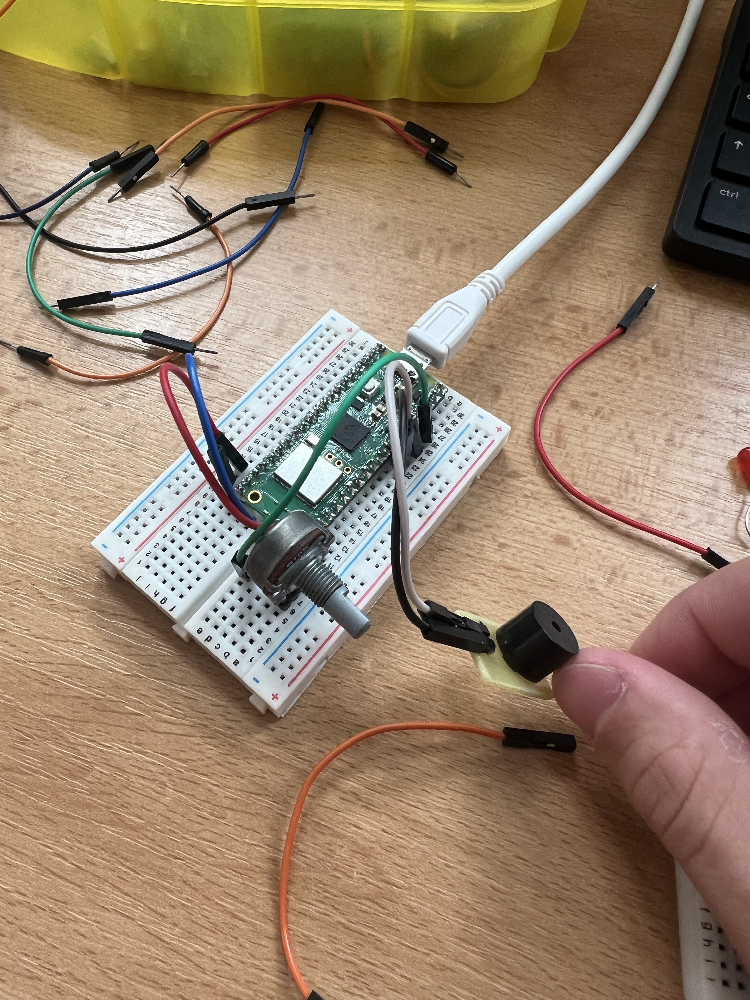

# Úloha 2: Analogový vstup a PWM výstup (Analog I/O)

Úloha demonstruje čtení analogového napětí pomocí ADC převodníku a řízení frekvence piezo bzučáku přes PWM.

## Popis funkce
Program čte analogovou hodnotu z potenciometru na pinu GP26 (ADC0, rozsah 0–65535). Tuto hodnotu lineárně přepočítává funkcí `translate()` na frekvenci zvuku v rozsahu 200 Hz až 2000 Hz. Výsledná frekvence se nastavuje pro PWM výstup na pinu GP27 se střídou 50 %, takže otáčením potenciometru plynule měníme výšku tónu bzučáku.

## Použitý hardware
- Raspberry Pi Pico
- Potenciometr (např. 10 kΩ)
- Piezo bzučák (pasivní)
- Nepájivé pole a vodiče

## Zapojení
- **Potenciometr:**
  - Běžec (střední pin): **GP26** (Pin 31, ADC0)
  - Krajní piny: 3.3V (Pin 36) a GND (Pin 38)
- **Piezo bzučák:**
  - Kladný pól (+): **GP27** (Pin 32, PWM)
  - Záporný pól (-): GND (Pin 33 / 38)

Detailní zapojení je uvedeno v [zapojeni.md](zapojeni.md).

## Spuštění
Spusťte skript [buzzer.py](buzzer.py) na Raspberry Pi Pico.

## Foto

