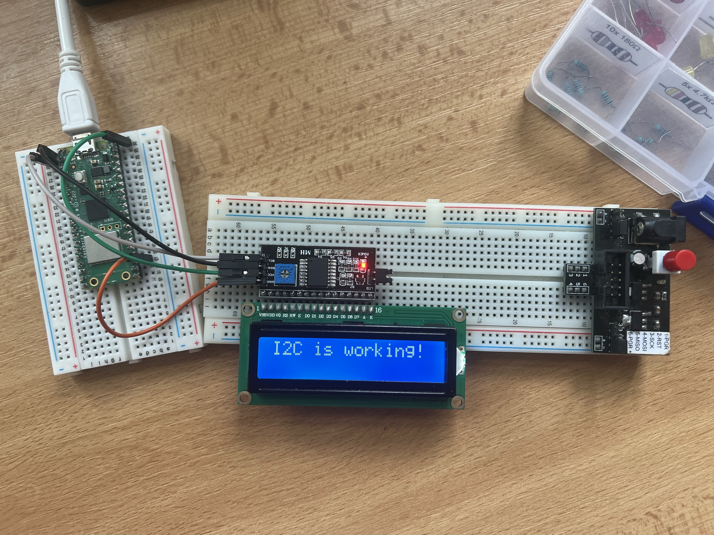

# Úloha 3: I2C sběrnice a LCD displej

Úloha demonstruje komunikaci přes sériovou sběrnici I2C s alfanumerickým LCD displejem 1602 a čtení vstupních dat ze senzorů.

## Popis funkce
Raspberry Pi Pico komunikuje pomocí sběrnice I2C (piny GP0/SDA a GP1/SCL) s I2C expandérem PCF8574 připojeným k displeji HD44780 (adresa `0x27`).
Program po úvodním pozdravu periodicky čte hodnotu z interního teplotního senzoru mikrokontroléru (ADC kanál 4) a stav tlačítka na GP14. Naměřenou teplotu a stav vstupu / čas v reálném čase zobrazuje na displeji.

## Použitý hardware
- Raspberry Pi Pico
- LCD displej 16x2 s I2C adaptérem (PCF8574)
- Fyzické tlačítko (volitelný vstup na GP14)
- Propojovací vodiče

## Zapojení
- **SDA:** GP0 (Pin 1)
- **SCL:** GP1 (Pin 2)
- **VCC:** VBUS (Pin 40, 5V)
- **GND:** GND (Pin 38)
- **Tlačítko:** GP14 (Pin 19) proti zemi GND

Detailní zapojení je v souboru [wiring.md](wiring.md).

## Soubory projektu
- [lcd.py](lcd.py) – hlavní program (čtení senzoru a zobrazení na LCD)
- [pico_i2c_lcd.py](pico_i2c_lcd.py) – ovladač I2C pro LCD
- [lcd_api.py](lcd_api.py) – API vrstva pro znakový LCD displej

## Foto

