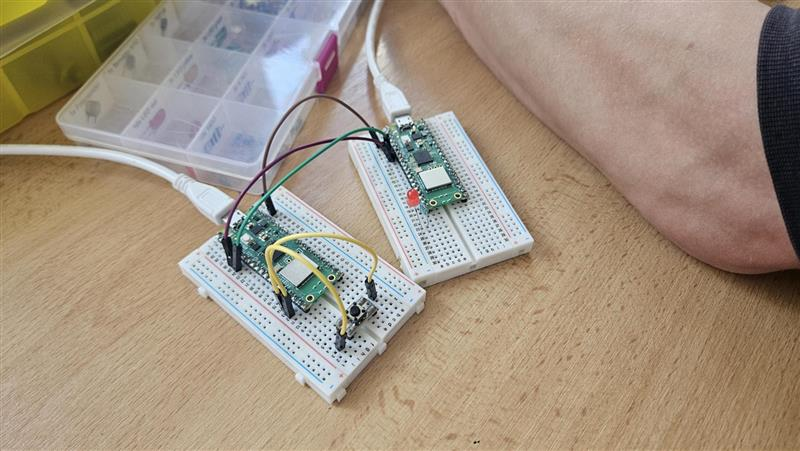

# Úloha 4: Drátová komunikace dvou Pico (UART)

Úloha realizuje sériovou komunikaci mezi dvěma mikrokontroléry Raspberry Pi Pico pomocí rozhraní UART.

## Popis funkce
- **Vysílač (Pico 1):** Sleduje stav tlačítka na pinu GP14. Po stisku tlačítka odešle přes UART1 (GP4/TX) řídicí bajt `b'1'`.
- **Přijímač (Pico 2):** Neustále naslouchá na sběrnici UART1 (GP5/RX). Jakmile přijme znak `b'1'`, sepne na 2 sekundy indikační LED diodu na pinu GP15.

## Použitý hardware
- 2× Raspberry Pi Pico
- Tlačítko
- LED dioda + ochranný rezistor (180–220 Ω)
- Propojovací vodiče

## Zapojení
Propojení mezi deskami (UART1, 9600 baud):
- **Vysílač TX (GP4)** -> **Přijímač RX (GP5)**
- **Vysílač RX (GP5)** -> **Přijímač TX (GP4)**
- **GND** vysílače spojeno s **GND** přijímače *(nezbytná společná zem!)*

Periferie:
- **Vysílač:** Tlačítko na GP14 a GND (interní pull-up)
- **Přijímač:** LED na GP15 přes rezistor do GND

## Programy
- [vysilac.py](vysilac.py) – program pro vysílající Pico
- [prijimac.py](prijimac.py) – program pro přijímající Pico

## Foto

