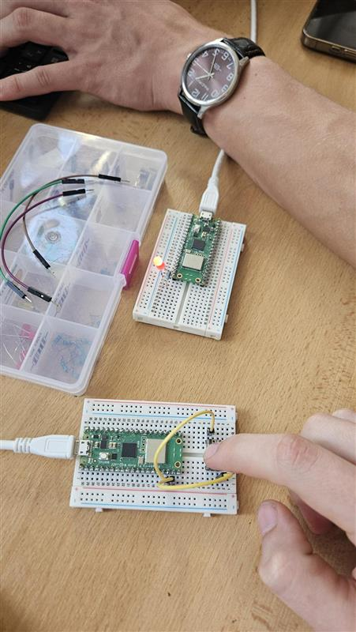

# Úloha 5: Bezdrátová komunikace dvou Pico W (Wi-Fi / UDP)

Úloha realizuje bezdrátový přenos stavu tlačítka mezi dvěma deskami Raspberry Pi Pico W.

## Popis funkce
- **Přijímač (Pico W 1):** Vytvoří vlastní Wi-Fi přístupový bod (Access Point s SSID `izrael`, IP `192.168.4.1`) a spustí UDP socket server na portu 5000. Po přijetí zprávy `"ON"` rozsvítí LED diodu na GP15, po přijetí `"OFF"` ji zhasne.
- **Vysílač (Pico W 2):** Připojí se jako klient (station) k Wi-Fi síti přijímače. Detekuje změnu stavu fyzického tlačítka na GP14 (stisk / uvolnění) a okamžitě odesílá odpovídající UDP paket (`"ON"` / `"OFF"`). LED tedy svítí po dobu držení tlačítka.

## Použitý hardware
- 2× Raspberry Pi Pico W (s Wi-Fi modulem)
- Tlačítko
- LED dioda + rezistor
- Napájení / USB kabely

## Zapojení
- **Vysílač:** Tlačítko na GP14 a GND (interní pull-up)
- **Přijímač:** LED na GP15 přes rezistor do GND

## Programy
- [vysilac.py](vysilac.py) – klient odesílající stav tlačítka přes UDP
- [prijimac.py](prijimac.py) – Access Point a UDP server ovládající LED

## Foto

