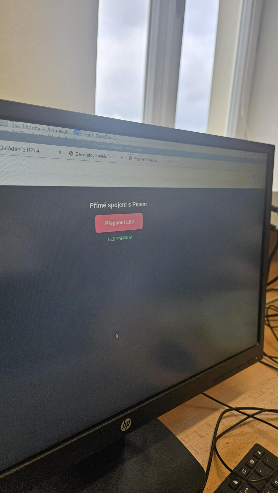
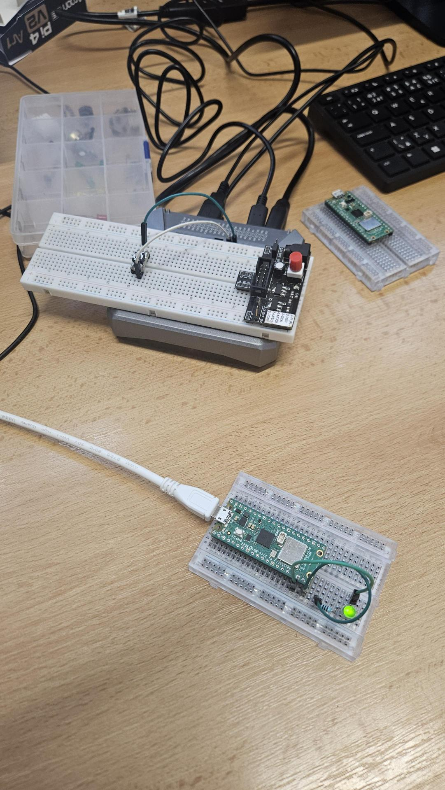

# Úloha 10: Wi-Fi komunikace Raspberry Pi 4 a Pico W (REST API)

Úloha realizuje bezdrátovou komunikaci mezi Raspberry Pi 4 a Raspberry Pi Pico W pomocí Wi-Fi sítě a HTTP protokolu (REST API).

## Popis funkce
- **Raspberry Pi Pico W:**
  - Vytvoří vlastní Wi-Fi přístupový bod (Access Point, SSID `Pico_Siet`, heslo `tajneheslo`) s IP adresou `192.168.4.1`.
  - Spustí odlehčený HTTP socket server na portu 80, který přijímá GET požadavky `/on` a `/off` a ovládá LED diodu na GP15.
- **Raspberry Pi 4:**
  - Připojí se k Wi-Fi síti vysílané Picem.
  - Spustí Flask webovou aplikaci na portu 8080.
  - LED diodu lze přepínat jak z webového rozhraní, tak fyzickým tlačítkem připojeným na GPIO 17.
  - Webové rozhraní se každých 500 ms dotazuje na endpoint `/state` a udržuje stav v reálném čase synchronizovaný. Fyzický stisk tlačítka na RPi se tak okamžitě projeví i na webové stránce.

## Použitý hardware
- Raspberry Pi 4
- Raspberry Pi Pico W
- Taktilní tlačítko
- LED dioda + rezistor
- Napájení / kabely

## Zapojení
- **Raspberry Pi 4:** Fyzické tlačítko mezi GPIO 17 (Pin 11) a GND (Pin 9)
- **Pico W:** LED dioda anoda na GP15 (Pin 20) přes rezistor 220 Ω do katody na GND (Pin 23)

## Postup spuštění
1. Na Picu W spusťte program [kod_pico.py](kod_pico.py) – Pico vytvoří Wi-Fi síť `Pico_Siet`.
2. Raspberry Pi 4 připojte k této Wi-Fi síti.
3. Na Raspberry Pi 4 spusťte program [kod_rpi4.py](kod_rpi4.py).
4. Otevřete v prohlížeči adresu Raspberry Pi (např. `http://192.168.4.2:8080`).

## Fotodokumentace

