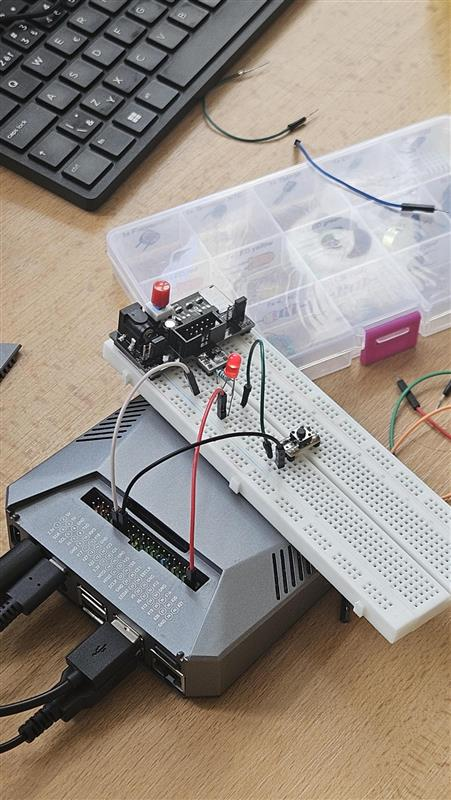

# Úloha 6: Digitální I/O a webové rozhraní (Raspberry Pi 4)

Úloha realizuje ovládání LED diody pomocí fyzického tlačítka a webového rozhraní na mikropočítači Raspberry Pi 4 s obousměrnou synchronizací stavu.

## Popis funkce
Na Raspberry Pi 4 běží webový server (Flask). LED diodu lze ovládat:
1. **Fyzickým tlačítkem** připojeným k GPIO pinu.
2. **Virtuálním tlačítkem** na webové stránce.

Stav LED je plně synchronizován v reálném čase. Webová stránka se každých 500 ms dotazuje na endpoint `/api/state`, takže stisk fyzického tlačítka se ihned projeví změnou stavu i v prohlížeči.

## Použitý hardware
- Raspberry Pi 4 (Argon)
- LED dioda + ochranný rezistor (220–330 Ω)
- Taktilní tlačítko
- Propojovací vodiče

## Zapojení (konektor GPIO Raspberry Pi 4)
- **LED dioda:** Anoda přes rezistor na **GPIO 17** (fyzický pin 11), katoda na **GND** (fyzický pin 9)
- **Tlačítko:** **GPIO 27** (fyzický pin 13) a **GND** (fyzický pin 14) – využit interní pull-up rezistor

## Programy
- [app.py](app.py) / [kod123456789.py](kod123456789.py) – Flask webová aplikace a obsluha GPIO přes knihovnu `gpiozero`

## Foto

