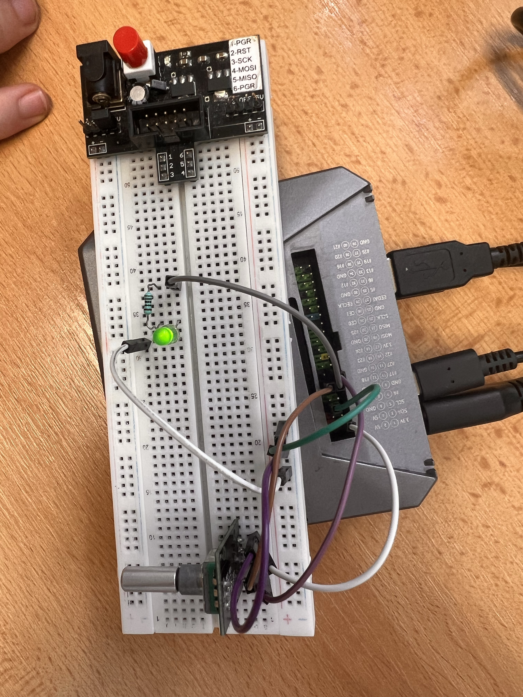

# Úloha 7: Analogové řízení a PWM výstup na Raspberry Pi 4

Úloha realizuje plynulé řízení jasu LED diody pomocí rotačního enkodéru a webového rozhraní s posuvníkem (sliderem).

## Popis funkce
Jas LED diody je řízen signálem PWM (Pulse Width Modulation) v rozsahu 0 až 100 %.
- **Fyzické ovládání:** Otáčením rotačního enkodéru se inkrementuje či dekrementuje hodnota kroků. Každý krok okamžitě mění střídu PWM signálu pro LED.
- **Webové ovládání:** Webová stránka nabízí interaktivní posuvník (`<input type="range">`), který přes AJAX volá `/set?val=...` a mění jas LED.
- **Synchronizace:** Webová stránka se každých 500 ms dotazuje na endpoint `/get`, takže při pootočení fyzickým enkodérem se posuvník na webu automaticky posune na novou hodnotu.

## Použitý hardware
- Raspberry Pi 4
- Rotační enkodér (modul KY-040)
- LED dioda + ochranný rezistor (220 Ω)
- Propojovací vodiče

## Zapojení
- **LED dioda:**
  - Anoda (+) přes ochranný rezistor do **GPIO 17** (Pin 11)
  - Katoda (-) do **GND** (Pin 9)
- **Rotační enkodér:**
  - **VDD (+):** 3.3V (Pin 1)
  - **GND:** GND (Pin 6)
  - **CLK (pin A):** GPIO 27 (Pin 13)
  - **DT (pin B):** GPIO 18 (Pin 12)

Podrobnější popis zapojení je v [zapojeni.md](zapojeni.md).

## Program
- [kod.py](kod.py) – Flask webový server využívající knihovnu `gpiozero` (`RotaryEncoder`, `PWMLED`).

## Foto

