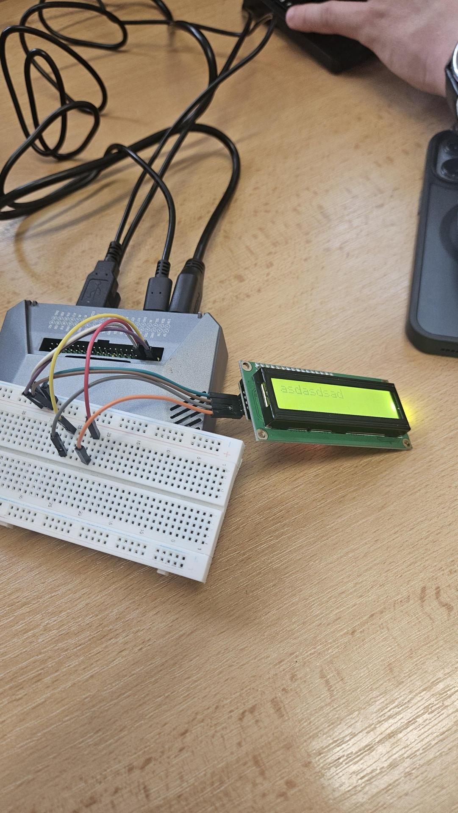
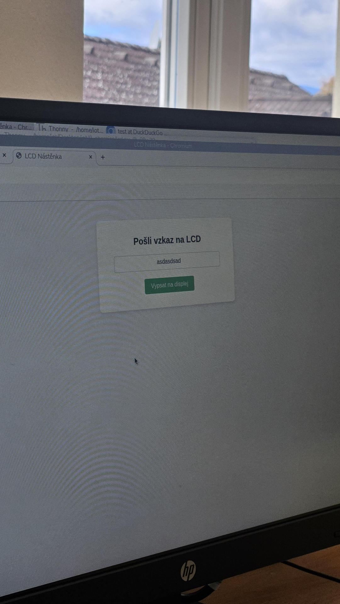

# Úloha 8: I2C sběrnice a LCD displej na Raspberry Pi 4

Úloha demonstruje připojení alfanumerického LCD displeje 1602 k Raspberry Pi 4 přes I2C sběrnici (PCF8574 expandér) s kombinovaným vstupem (webové rozhraní + fyzické tlačítko).

## Popis funkce
- **Výstup:** Dvouřádkový LCD displej 1602 komunikující po I2C sběrnici (adresa `0x27`).
- **Vstup 1 (Web):** Přes Flask webové rozhraní lze zadat libovolný textový vzkaz (až 16 znaků na řádek), který se odešle a ihned zobrazí na displeji.
- **Vstup 2 (Fyzické tlačítko):** Tlačítko na GPIO 17 umožňuje přímo z hardware přepínat režim zobrazení mezi textovým vzkazem a systémovými informacemi (aktuální IP adresa maliny, čas a počítadlo stisků).
- Webové rozhraní obsahuje živý náhled aktuálního obsahu obou řádků LCD displeje.

## Použitý hardware
- Raspberry Pi 4
- Znakový LCD displej 1602 s I2C převodníkem PCF8574
- Taktilní tlačítko na GPIO 17
- Propojovací vodiče

## Zapojení
- **LCD Displej:**
  - GND -> Pin 6 (GND)
  - VCC -> Pin 2 (5V)
  - SDA -> Pin 3 (GPIO 2)
  - SCL -> Pin 5 (GPIO 3)
- **Fyzické tlačítko:** Pin 11 (GPIO 17) a Pin 9 (GND)

Detailní schéma zapojení je v [zapojeni.md](zapojeni.md).

## Program
- [kod.py](kod.py) – Flask webový server obsluhující I2C displej pomocí knihovny `RPLCD` a tlačítko přes `gpiozero`.

## Fotodokumentace

