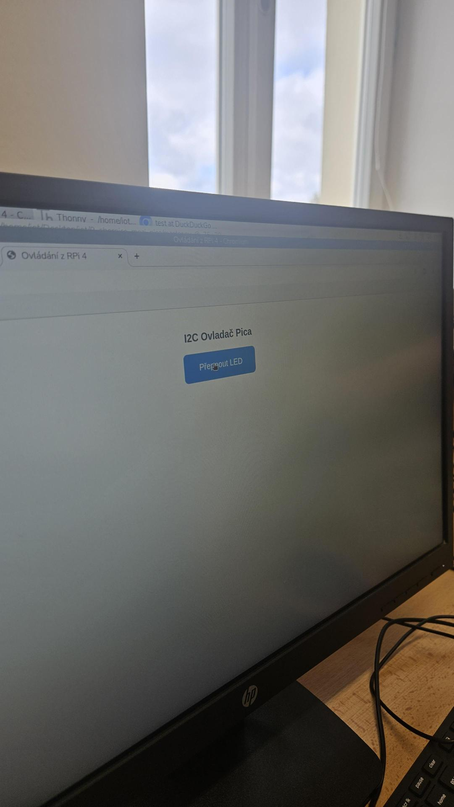
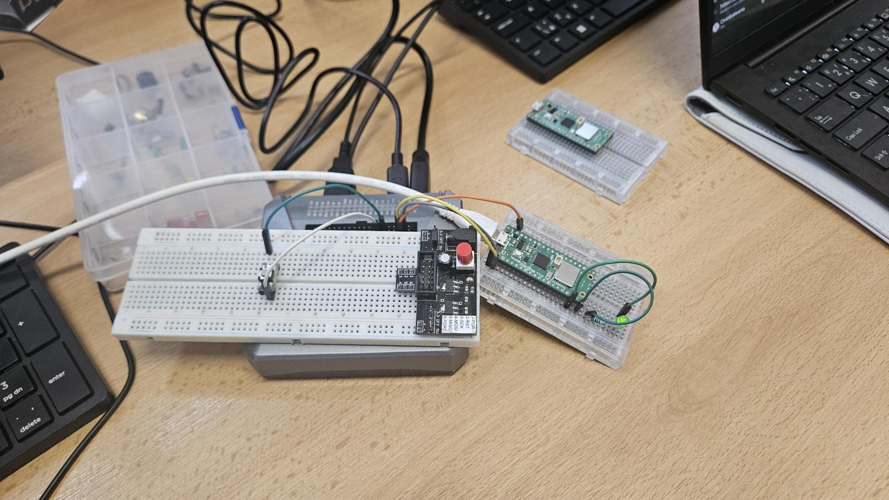

# Úloha 9: I2C komunikace Raspberry Pi 4 (Master) a Pico (Slave)

Úloha realizuje komunikaci po sběrnici I2C mezi Raspberry Pi 4 v roli Mastera a Raspberry Pi Pico v roli zařízení Slave.

## Popis funkce
- **I2C Master (Raspberry Pi 4):**
  - Běží zde webový server Flask s webovou stránkou na portu 8080.
  - K RPi 4 je připojeno fyzické tlačítko na GPIO 17.
  - Stisknutím tlačítka (na webu nebo fyzického) se přepne proměnná stavu a přes I2C sběrnici (adresa `0x41`) se do Pica odešle bajt (`1` pro zapnutí, `0` pro vypnutí).
  - Webové rozhraní zobrazuje aktuální stav LED diody (ZAPNUTO / VYPNUTO) a každých 500 ms se synchronizuje se serverem, takže fyzický stisk tlačítka se okamžitě projeví na displeji počítače/telefonu.
- **I2C Slave (Raspberry Pi Pico):**
  - Přímým zápisem do hardwarových registrů RP2040 (`mem32`) je I2C řadič nakonfigurován do režimu Slave na adrese `0x41`.
  - Neustále sleduje FIFO přijímače a podle přijatého bajtu rozsvěcí či zhasíná externí LED na GP15.

## Použitý hardware
- Raspberry Pi 4
- Raspberry Pi Pico
- Taktilní tlačítko
- LED dioda + rezistor (220 Ω)
- Propojovací vodiče

## Zapojení
Propojení sběrnice I2C (Master <-> Slave):
- **SDA:** RPi 4 Pin 3 (GPIO 2) <-> Pico Pin 1 (GP0)
- **SCL:** RPi 4 Pin 5 (GPIO 3) <-> Pico Pin 2 (GP1)
- **GND:** RPi 4 Pin 6 (GND) <-> Pico Pin 38 (GND) *(společná zem)*

Periferie:
- **Tlačítko na RPi 4:** Pin 11 (GPIO 17) a Pin 9 (GND)
- **LED na Pico:** GP15 (Pin 20) přes rezistor 220 Ω do GND (Pin 23)

Detailní popis je v [zapojeni.md](zapojeni.md).

## Programy
- [master.py](master.py) – Flask server a I2C Master na Raspberry Pi 4
- [slave.py](slave.py) – I2C Slave obsluha s přímým přístupem do registrů RP2040

## Fotodokumentace

